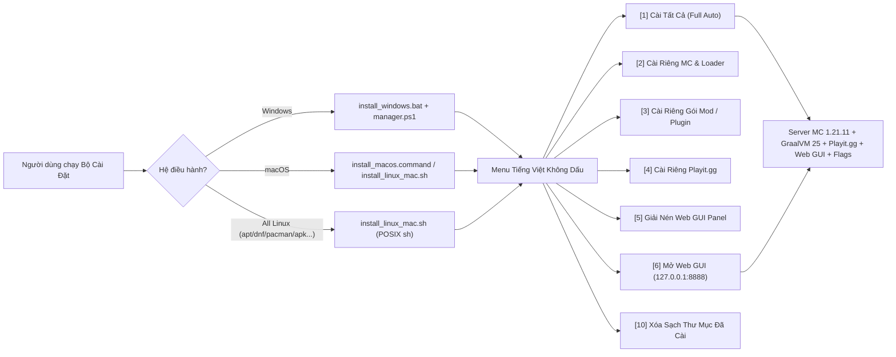
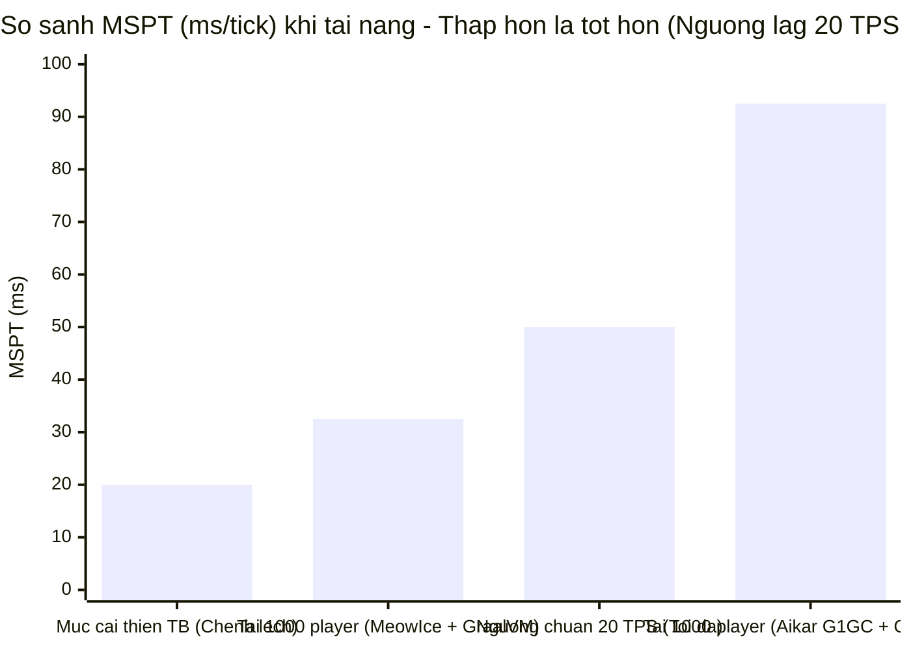
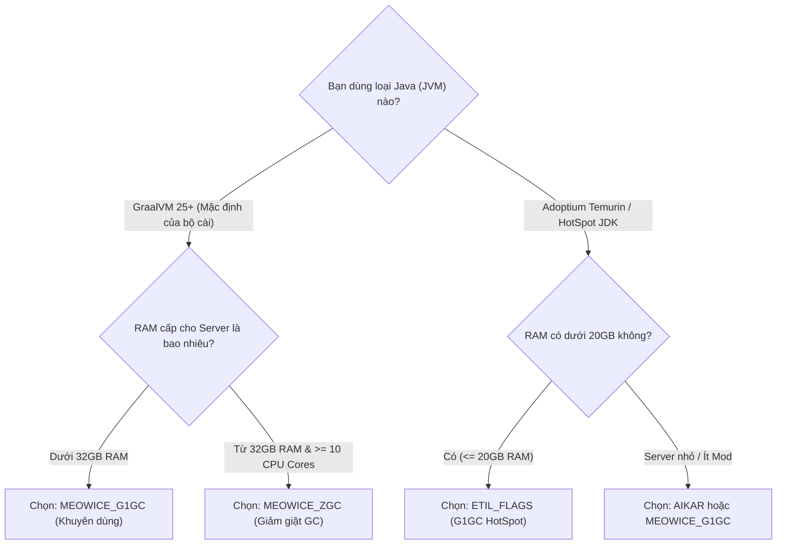

<div align="center">

# 🎮 TRÌNH CÀI ĐẶT & QUẢN LÝ SERVER MINECRAFT TỰ ĐỘNG (WIN / MAC / ALL LINUX)


**Cài đặt tự động Minecraft `1.21.11` • Giao diện Web GUI quản lý toàn diện • Chuyển đổi Version & Loader (`Fabric`, `Paper`, `Purpur`, `Leaf`, `NeoForge`, `Forge`, `Vanilla`) • Kho cài Mod/Plugin Modrinth • Tích hợp sẵn `Playit.gg` (`playgit.gg`) • Tối ưu bằng `MeowIce Flags` & `Etil Flags`**

</div>

---

## 📌 Mục Lục
- [✨ Tính Năng Nổi Bật](#-tính-năng-nổi-bật)
- [🧭 Kiến Trúc & Luồng Hoạt Động](#-kiến-trúc--luồng-hoạt-động)
- [🚀 Hướng Dẫn Sử Dụng Nhanh](#-hướng-dẫn-sử-dụng-nhanh)
- [🌐 Kết Nối Playit.gg Không Cần Mở Port](#-kết-nối-playitgg-không-cần-mở-port)
- [⚔️ So Sánh Chuyên Sâu: Etil Flags vs MeowIce Flags](#️-so-sánh-chuyên-sâu-etil-flags-vs-meowice-flags)
- [📊 Biểu Đồ Trực Quan & Sơ Đồ Lựa Chọn Flags](#-biểu-đồ-trực-quan--sơ-đồ-lựa-chọn-flags)
- [🛡️ Cam Kết Trách Nhiệm (Không Miễn Trừ Trách Nhiệm)](#️-cam-kết-trách-nhiệm-không-miễn-trừ-trách-nhiệm)
- [👨‍💻 Người Làm Dự Án & Nguồn Đóng Góp](#-người-làm-dự-án--nguồn-đóng-góp)

---

## ✨ Tính Năng Nổi Bật

1. **Menu Terminal Tiếng Việt Không Dấu (Chống Lỗi Font 100%)**:
   - Giao diện dòng lệnh được thiết kế bằng tiếng Việt không dấu để hiển thị sắc nét trên mọi CMD, PowerShell, Terminal macOS và SSH Linux mà không gặp lỗi vỡ ký tự Unicode.
2. **Cài Đặt Im Lặng (Silent Mode) Chỉ Hiện Thời Gian Thực**:
   - Toàn bộ log tải xuống và lệnh cài đặt chạy ngầm hoàn toàn, không làm rối màn hình.
   - Trong lúc cài chỉ hiển thị 1 dòng đồng hồ đếm thời gian (`[DANG CAI DAT] ... | Thoi gian: 00:08s`) và thông báo `[HOAN THANH]` kèm tổng thời gian sau khi xong.
3. **Chọn Chế Độ Cài Đặt Linh Hoạt Ngay Trong Menu**:
   - **Chế độ `[1]` — Cài đặt tất cả (Full Auto)**: Tự cài GraalVM Java 25 + MC `1.21.11` + Loader (`Fabric` mặc định) + Giao diện Web GUI + Playit.gg + MeowIce Flags.
   - **Chế độ `[2]` — Cài riêng Server Minecraft & Loader**: Tự chọn phiên bản MC bất kỳ (`1.21.11`, `1.21.10`, `1.20.1`, `1.16.5`, `1.12.2`...) và Loader (`Fabric`, `PaperMC`, `Purpur`, `LeafMC`, `NeoForge`, `Forge`, `Vanilla`).
   - **Chế độ `[3]` — Cài riêng Gói Mod / Plugin**: Cài gói tối ưu sẵn, tìm/tải theo slug Modrinth, hoặc dán link `.jar` trực tiếp.
   - **Chế độ `[4]` — Cài riêng Playit.gg (`playgit.gg`)**: Mở IP công khai không cần mở Port Router hay dùng Radmin/Hamachi.
   - **Chế độ `[5]` — Cài riêng Giao diện Quản lý Web GUI**: Giải nén Web Panel được đóng gói sẵn bên trong bộ cài & chuẩn bị Java Runtime.
   - **Tùy chọn `[10]` — Xóa toàn bộ thư mục đã cài**: Dọn sạch `server/`, `runtime/`, `playit/`, `web_panel/`, `logs/`, `server_config.json` chỉ với 1 lần chọn.
4. **Hỗ Trợ Toàn Bộ Các Bản Phân Phối Linux, macOS & Windows**:
   - **Windows**: Chạy trực tiếp qua `install_windows.bat` + `manager.ps1`.
   - **macOS (Intel & Apple Silicon `M1/M2/M3/M4`)**: Nhấn đúp `install_macos.command` hoặc chạy `sh install_linux_mac.sh`.
   - **Toàn bộ Linux (`glibc` và `musl`)**: Tự nhận diện trình quản lý gói (`apt-get`, `dnf`, `yum`, `pacman`, `zypper`, `apk`, `xbps-install`, `emerge`, `eopkg`, `nix-env`) và kiến trúc CPU (`x86_64`, `aarch64`/`ARM64`).
5. **Giao Diện Quản Lý Web GUI (`http://127.0.0.1:8888`)**:
   - Bật/Tắt/Khởi động lại Server & Playit.gg, xem Console trực tiếp và gửi lệnh quản trị.
   - Đổi phiên bản MC & Loader, cài/upload/bật/tắt/xóa Mod & Plugin từ **Modrinth**, chỉnh RAM, chuyển đổi Flags và sửa `server.properties`.

---

## 🧭 Kiến Trúc & Luồng Hoạt Động



> [!NOTE]
> Trước khi bạn chọn cài đặt trong menu, thư mục dự án luôn gọn gàng chỉ gồm 5 tệp khởi chạy & tài liệu. Các thư mục như `runtime/`, `server/`, `web_panel/`, `playit/`, `logs/` chỉ được tạo ra khi bạn chọn chế độ cài tương ứng.

---

## 🚀 Hướng Dẫn Sử Dụng Nhanh

| Hệ Điều Hành | Cách Khởi Chạy | Ghi Chú |
| :--- | :--- | :--- |
| **Windows 10 / 11** | Nhấn đúp `install_windows.bat` | Không cần cài sẵn Java, Python hay Node.js |
| **Toàn bộ Linux** | `chmod +x install_linux_mac.sh && sh install_linux_mac.sh` | Hỗ trợ Ubuntu, Debian, Fedora, Arch, Alpine (`musl`), CentOS, openSUSE, Void, Gentoo, NixOS... |
| **macOS (Intel / Apple Silicon)** | Nhấn đúp `install_macos.command` hoặc `sh install_linux_mac.sh` | Tự động gỡ các cờ x86 AVX/XMM trên chip Apple Silicon (`arm64`) |

### Các Bước Bắt Đầu Cho Người Mới
1. Mở bộ cài phù hợp với hệ điều hành của bạn.
2. Chọn **`[1]`** để tự động cài toàn bộ (**Java 25 GraalVM + Minecraft `1.21.11` + Fabric + Web GUI + Playit.gg + MeowIce Flags**).
3. Chờ đồng hồ đếm thời gian chạy xong và hiện **`[HOAN THANH]`**.
4. Chọn **`[6]`** để mở **Giao diện Web GUI** trên trình duyệt (`http://127.0.0.1:8888`) hoặc chọn **`[7]`** để bật Server ngay.

---

## 🌐 Kết Nối Playit.gg Không Cần Mở Port

1. Khởi chạy Server kèm **Playit.gg** (từ Menu `[7]` hoặc bấm **Bat Playit.gg** trên Web GUI).
2. Khi Playit.gg tạo liên kết dạng `https://playit.gg/claim/...` (Web GUI sẽ tự động bắt và hiển thị nút bấm màu xanh), hãy mở liên kết đó trên trình duyệt.
3. Đăng nhập tài khoản Playit.gg miễn phí → chọn **Add Tunnel** → chọn **Minecraft Java** (Port cục bộ `25565`).
4. Copy địa chỉ IP/tên miền công khai mà Playit.gg cấp để bạn bè kết nối vào server!

---

## ⚔️ So Sánh Chuyên Sâu: Etil Flags vs MeowIce Flags

Bộ cài đặt tích hợp sẵn cả hai bộ cờ tối ưu JVM nổi tiếng nhất cộng đồng Minecraft:
- **MeowIce's Flags** *(Mặc định)*: [`https://github.com/MeowIce/meowice-flags`](https://github.com/MeowIce/meowice-flags)
- **Etil's Minecraft Flags**: [`https://github.com/etil2jz/etil-minecraft-flags`](https://github.com/etil2jz/etil-minecraft-flags)

### Bảng Đối Chiếu Kỹ Thuật Chi Tiết

| Tiêu Chí So Sánh | `etil2jz/etil-minecraft-flags` | `MeowIce/meowice-flags` |
| :--- | :--- | :--- |
| **Nền tảng & Triết lý** | Mở rộng từ **Aikar's Flags**, tinh chỉnh cho **HotSpot C2 JIT** trên Java 17/18+. | Thiết kế mới cho **Java 25+**, **Minecraft 1.21+** và **GraalVM JIT**, tận dụng chỉ thị vector và tối ưu bộ nhớ hiện đại. |
| **JVM Khuyên Dùng** | **Adoptium (Eclipse Temurin)** / HotSpot chuẩn. | **GraalVM** (Community / Enterprise) với `-XX:+EagerJVMCI` và các tham số `-Djdk.graal.*`. |
| **Bộ Thu Gom Rác (GC)** | Chỉ dùng **G1GC** với 2 cấu hình (`<=12GB RAM` và `>12GB RAM`); khuyến cáo không dùng quá `20GB RAM`. | Hỗ trợ cả **G1GC** (`< 32GB RAM`) và **ZGC** (`-XX:+UseZGC -XX:-ZProactive` cho server `>= 32GB RAM` & `>= 10 cores`). |
| **Tinh Chỉnh G1GC** | `G1NewSizePercent` `30–40%`, `G1MaxNewSizePercent` `40–50%`, `G1HeapRegionSize` `8M/16M`, `G1MixedGCCountTarget=4`, `G1RSetUpdatingPauseTimePercent=5`. | `G1NewSizePercent=28%`, `G1MaxNewSizePercent=50%`, `G1HeapRegionSize=16M`, `G1MixedGCCountTarget=3`, `G1RSetUpdatingPauseTimePercent=0`, `G1SATBBufferEnqueueingThresholdPercent=30`, `G1ConcMarkStepDurationMillis=5`. |
| **Chỉ Thị Vector CPU** | `-XX:UseAVX=3` (ưu tiên AVX-512) + `-XX:UseSSE=4`. | `-XX:UseAVX=2` (tương thích rộng rãi hầu hết CPU x86_64) + `-XX:UseSSE=4`. |
| **Cờ Đặc Thù / Hiện Đại** | Giữ một số cờ từ thế hệ Java cũ như `-XX:-UseBiasedLocking`, `-XX:ThreadPriorityPolicy=1`, `-XX:+TrustFinalNonStaticFields`, `-XX:+UseCodeCacheFlushing`, `-Xlog:async`. | Bổ sung phân tầng CodeCache (`400M`/`12M`/`194M`/`194M`), `-XX:+UseCompactObjectHeaders`, `-XX:+UseTransparentHugePages`, `-XX:LargePageSizeInBytes=2M`, `-XX:+UseCriticalJavaThreadPriority`. |
| **Tối Ưu GraalVM & Leaf** | Không có nhóm tham số `-Djdk.graal.*` hay `-DLeaf.enableFMA`. | Có đầy đủ `-Djdk.graal.*` (`UsePriorityInlining`, `Vectorization`, `LoopRotation`, `StripMineNonCountedLoops`...) và `-DLeaf.enableFMA=true`. |
| **Hỗ Trợ ARM64 (Apple Silicon / VPS ARM)** | Yêu cầu người dùng tự loại bỏ các cờ x86 nếu chạy ARM64. | Tài liệu chỉ rõ danh sách cờ x86 cần bỏ trên ARM64 (bộ cài này **tự động loại bỏ** khi phát hiện ARM64). |

> [!TIP]
> **Điều chỉnh tương thích thông minh trong bộ cài này**: Bản gốc của MeowIce có vài tham số dành riêng cho GraalVM Enterprise (`EnterprisePartialUnroll`, `VectorizeSIMD`, `CompilerConfiguration=enterprise`) sẽ gây crash khi chạy trên **GraalVM Community Edition (CE)**. Bộ cài đặt của chúng tôi đã tự động chuyển sang `CompilerConfiguration=community`, loại bỏ 2 cờ EE-only nói trên và chèn `-XX:+IgnoreUnrecognizedVMOptions`, giúp chạy mượt mà 100% trên cả GraalVM CE 25 lẫn Temurin 21!

---

## 📊 Biểu Đồ Trực Quan & Sơ Đồ Lựa Chọn Flags

### 1. Biểu Đồ So Sánh MSPT Theo Dữ Liệu Benchmark (Càng Thấp Càng Mượt)

Theo số liệu benchmark do tác giả **MeowIce** công bố trên máy chủ thử nghiệm (`leaf-1.21.8`, `6GB RAM`, CPU `i7-10700K @ 5.0GHz`, mô phỏng tới `1.000 người chơi`), khi so sánh nền tảng **G1GC truyền thống (Aikar + OpenJDK — nền gốc mà Etil kế thừa)** với **MeowIce Flags + GraalVM**:



### 2. Bảng Điểm Trực Quan Đặc Tính Kỹ Thuật (Etil vs MeowIce)

```text
TÍNH NĂNG / KHẢ NĂNG TỐI ƯU                ETIL FLAGS               MEOWICE FLAGS
─────────────────────────────────────────  ───────────────────────  ───────────────────────
Tối ưu Java 21-25+ & GraalVM JIT           [██████░░░░] 60%         [██████████] 100%
Hỗ trợ RAM lớn >= 32GB (ZGC)               [██░░░░░░░░] 20%         [██████████] 100%
Tương thích đa số CPU x86 (AVX2)           [███████░░░] 70%         [██████████] 100%
Độ ổn định trên Adoptium / HotSpot JDK     [█████████░] 90%         [████████░░] 80%
Hiệu năng tải cao trên MC 1.21.x           [███████░░░] 75%         [██████████] 98%
```

### 3. Sơ Đồ Quyết Định Chọn Bộ Flags Cho Server Của Bạn



---

## 🛡️ Cam Kết Trách Nhiệm (Không Miễn Trừ Trách Nhiệm)

> [!IMPORTANT]
> **CHÍNH SÁCH KHÔNG MIỄN TRỪ TRÁCH NHIỆM (NON-DISCLAIMER COMMITMENT)**
>
> Khác với phần lớn các script/công cụ trên mạng thường đính kèm điều khoản *"từ chối mọi trách nhiệm"* (ví dụ như mục Disclaimer trong `etil-minecraft-flags`), **người làm dự án này khẳng định KHÔNG MIỄN TRỪ TRÁCH NHIỆM** đối với độ an toàn, tính minh bạch và chất lượng vận hành của bộ script cài đặt này:

1. **Minh bạch mã nguồn 100%**: Toàn bộ mã nguồn (`install_windows.bat`, `manager.ps1`, `install_linux_mac.sh`, `install_macos.command`, và mã Web GUI tích hợp bên trong) đều ở dạng văn bản mở để bất kỳ ai cũng có thể đọc và kiểm tra trực tiếp. Cam kết tuyệt đối **không chứa mã độc, backdoor, keylogger hay thu thập dữ liệu người dùng**.
2. **Chỉ tải từ nguồn chính chủ**: Mọi tệp nhị phân (Java, Server Jar, Mod/Plugin, Playit.gg) đều được tải trực tiếp từ API và trang phát hành chính thức của nhà sản xuất: **Mojang**, **FabricMC**, **PaperMC**, **PurpurMC**, **LeafMC**, **NeoForged**, **MinecraftForge**, **Modrinth**, **GitHub GraalVM CE**, **Eclipse Adoptium** và **Playit-Cloud**.
3. **Chịu trách nhiệm sửa lỗi & hỗ trợ**: Nếu xảy ra bất kỳ lỗi nào phát sinh từ mã nguồn bộ cài đặt (lỗi tải, lỗi phân quyền, lỗi cờ JVM, lỗi xung đột cấu hình do script tạo ra), **tác giả dự án cam kết tiếp nhận phản hồi, chịu trách nhiệm khắc phục và phát hành bản sửa lỗi kịp thời**.
4. **Lưu ý phối hợp từ người dùng**: Người dùng cần tự kiểm soát nội dung/bản quyền các Mod hoặc Plugin bên thứ ba do chính mình tải thêm vào `mods/` hoặc `plugins/`, đồng thời chủ động sao lưu thư mục `world/` trước khi nâng/hạ phiên bản Minecraft lớn.

---

## 👨‍💻 Người Làm Dự Án & Nguồn Đóng Góp

### Thông Tin Người Làm Dự Án (Author & Maintainer)
| Hạng mục | Thông tin |
| :--- | :--- |
| **Tác giả / Người làm dự án** | **Nguyễn Văn Duy** *(Project Creator & Maintainer — MC Server VN Suite)* |
| **Vai trò thực hiện** | Thiết kế kiến trúc đa nền tảng (Windows / macOS / Toàn bộ Linux), xây dựng cơ chế cài đặt silent kèm bộ đếm thời gian, đóng gói Giao diện Web GUI (`WebServer.java` + `index.html`), tích hợp `Playit.gg` và chuẩn hóa tương thích `MeowIce Flags` + `Etil Flags` trên GraalVM CE 25 & ARM64. |
| **Phiên bản phát hành** | `v1.0.0` (Hỗ trợ mặc định **Minecraft `1.21.11`** & đa phiên bản) |
| **Hỗ trợ & Báo lỗi** | Tiếp nhận góp ý và báo lỗi trực tiếp qua Issue / kênh hỗ trợ của dự án. |

*(Bạn có thể thay đổi tên tác giả hoặc thông tin liên hệ cá nhân tại bảng trên nếu phân phối lại bộ cài đặt này.)*

### Nguồn Dự Án Mã Nguồn Mở Được Tích Hợp & Tham Khảo
- ⚡ **MeowIce's Flags**: [`https://github.com/MeowIce/meowice-flags`](https://github.com/MeowIce/meowice-flags)
- 🛠️ **Etil's Minecraft Flags**: [`https://github.com/etil2jz/etil-minecraft-flags`](https://github.com/etil2jz/etil-minecraft-flags)
- 🌍 **Playit.gg Agent**: [`https://github.com/playit-cloud/playit-agent`](https://github.com/playit-cloud/playit-agent)
- ☕ **GraalVM Community Builds**: [`https://github.com/graalvm/graalvm-ce-builds`](https://github.com/graalvm/graalvm-ce-builds) & **Eclipse Adoptium**: [`https://adoptium.net`](https://adoptium.net)
- 🧩 **Server & Modding Ecosystem**: **Mojang** • **FabricMC** • **PaperMC** • **PurpurMC** • **LeafMC** • **NeoForged** • **MinecraftForge** • **Modrinth**
